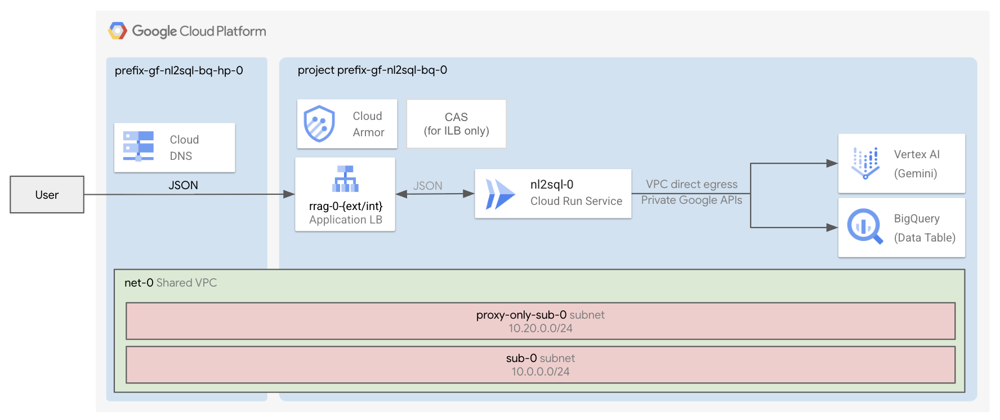

# Natural Language to SQL (NL2SQL) for BigQuery

This factory deploys a "Natural Language 2 SQL" (NL2SQL) agent on Cloud Run that allows users query a datasets in BigQuery by using natural language.

## Core Components

The deployment includes:

- An **agent** running on **Cloud Run** (configured with authentication, direct VPC egress, Model Armor prompt/response screening, and an AST-enforced BigQuery dataset SQL allowlist).

- **Model Armor** template and Vertex AI floor settings to inspect and block prompt injection, jailbreak attempts, sensitive data exposure, malicious URIs, and unsafe content.

- An **exposure layer** that allows you to securely access your instance of Cloud Run, made of:
  - a **Global external application load balancer** (+ Cloud Armor IP allowlist security backend policy + HTTP to HTTPS redirect + managed certificates). This is created by default.
  - an **Internal application load balancer** (+ Cloud Armor IP allowlist security backend policy + HTTP to HTTPS redirect + managed certificates + CAS + Cloud DNS private zone). This is optional.

- By default, a **host project**, a **shared VPC**, a subnet, private Google APIs routes and DNS policies. Optionally, you can use your own host project and shared VPCs.

- A **service project** with all the necessary APIs, service accounts, permissions set.

## Apply the factory

- Enter the [0-prereqs](0-prereqs/README.md) folder and follow the instructions to setup your GCP project, service accounts and permissions
- Go to the [1-apps](1-apps/README.md) folder and follow the instructions to deploy the components inside the project
