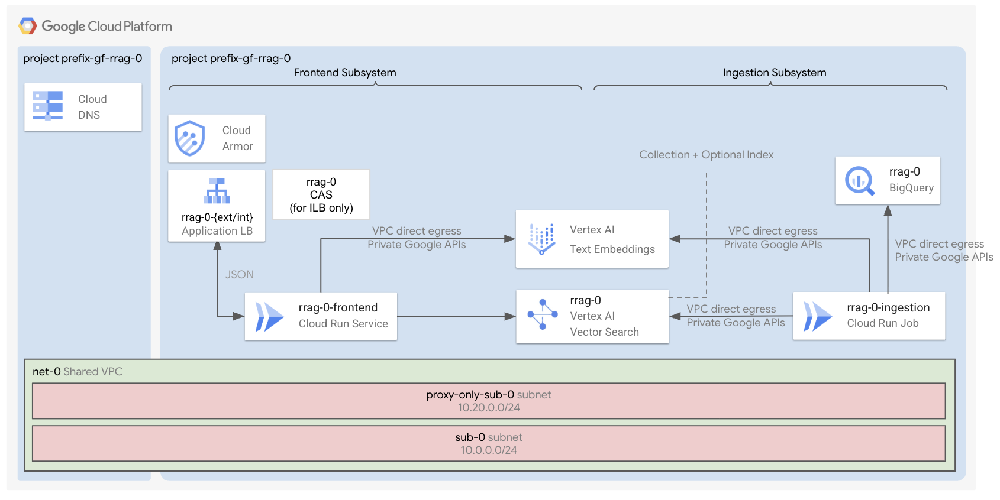

# RAG with Cloud Run and Vector Search

This module deploys a "Retrieval-Augmented Generation" (RAG) system, leveraging Cloud Run and Vertex AI Vector Search 2.0.

A Cloud Run job periodically ingests sample [movies data](./1-apps/data/data.jsonl) from Cloud Storage into a **Vector Search 2.0 Collection**, which automatically generates embeddings (`gemini-embedding-001`) from the ingested document fields and stores both the structured metadata and embeddings together. Another Cloud Run frontend application queries the Vector Search 2.0 Collection using **Hybrid Search** (Semantic Search + Text Search combined with Reciprocal Rank Fusion) and answers questions on movies in JSON format using Gemini.

## Core Components

The deployment includes:

- An **ingestion subsystem**, made of a private **Cloud Run job** with direct egress access to the user VPC, that reads sample data from **Cloud Storage** and upserts `DataObject` records into a **Vector Search 2.0 Collection** (with automatic Vertex AI embedding generation).

- **Databases**:

  - **Vector Search 2.0 Collection** (and an optional ScaNN **ANN Index**), storing both structured movie fields and automatically generated vector embeddings.

- A **frontend subsystem**, made of:

  - **Global external application load balancer** (+ Cloud Armor IP allowlist security backend policy + HTTP to HTTPS redirect + managed certificates). This is created by default.
  - **Internal application load balancer** (+ Cloud Armor IP allowlist security backend policy + HTTP to HTTPS redirect + managed certificates + CAS + Cloud DNS private zone). This is not created by default.
  - A private **Cloud Run** frontend with direct egress access to the user VPC, that performs Hybrid Search (Semantic + Text with RRF) against the Vector Search 2.0 Collection and answers user queries in JSON format.

- By default, a **host project**, a **shared VPC**, a subnet, private Google APIs routes and DNS policies. Optionally, you can use your own host project and shared VPCs.

- A **service project** with all the necessary APIs, service accounts, permissions set.

## Apply the factory

- Enter the [0-prereqs](0-prereqs/README.md) folder and follow the instructions to setup your GCP project, service accounts and permissions
- Go to the [1-apps](1-apps/README.md) folder and follow the instructions to deploy the components inside the project
