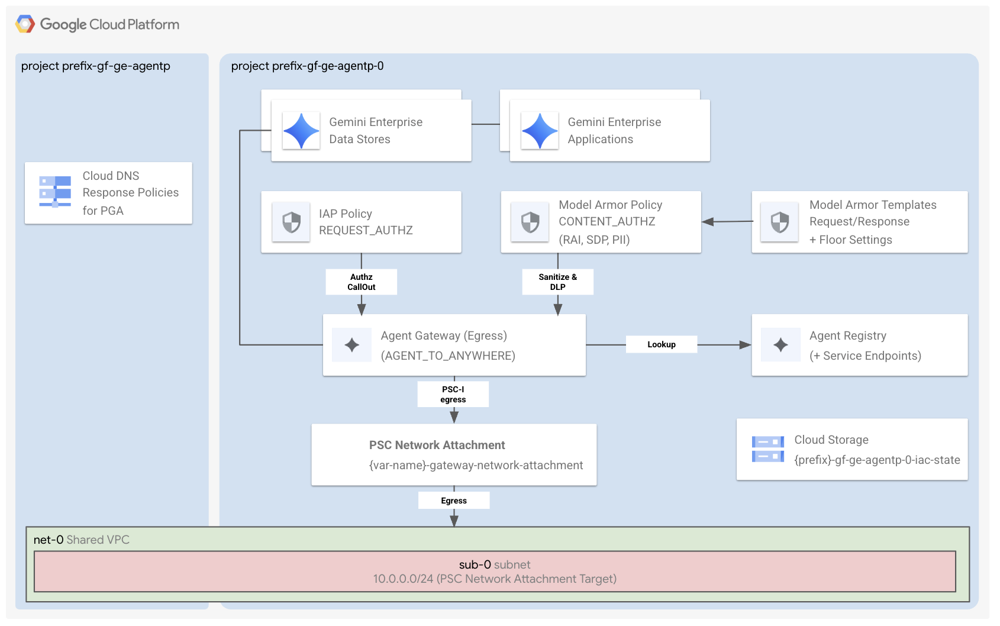

# Gemini Enterprise Agent Platform / Platform Deployment



This stage is part of the `Gemini Enterprise Agent Platform` factory.

It is responsible for deploying the components enabling the Gemini Enterprise Agent Platform inside the service project, created in [0-prereqs](../0-prereqs/README.md) or in an existing project.

It performs the following tasks:

- Configures location-level **Discovery Engine singletons**: identity provider / ACL configuration (`var.gemini_enterprise_iam`), default license assignment (`var.gemini_enterprise_user_store_config`), and CMEK encryption (`var.gemini_enterprise_encryption_config`).
- Deploys or adopts **Gemini Enterprise applications** (`APP_TYPE_INTRANET`), their opt-in **assistants**, search **widget configurations** (`widget_config`), Egress Agent Gateway bindings (with per-app opt-out), and app-level IAM (`iam`, `iam_by_principals`, `iam_bindings`, `iam_bindings_additive`) plus Antigravity access.
- Deploys native **Discovery Engine data stores and custom schemas** (`var.gemini_enterprise_data_stores`), and first-party/third-party **SaaS data connectors** (`var.gemini_enterprise_data_connectors`, such as Microsoft 365 Exchange Online/Outlook, OneDrive, SharePoint, Jira Cloud, Confluence Cloud, Google Drive, Gmail) in `DATA_INGESTION` or `FEDERATED` mode, attaching them to target apps via `app_ids` or `gemini_enterprise_apps[*].data_store_ids`.
- Registers service endpoints in **Agent Registry** (`var.agent_registry_services`):
  - Custom HTTP/gRPC endpoints, A2A agents, and **Custom MCP servers**.
  - Creates federated **Custom MCP data connectors** in Gemini Enterprise for registered MCP servers (`agent_gateway_app_ids`), routed through the Egress Agent Gateway with optional **OAuth 2.0** authentication backed by Secret Manager.
- Deploys the **Egress Agent Gateway** configured with `AGENT_TO_ANYWHERE` access path.
- Creates a Private Service Connect **(PSC) Network Attachment for Agent Gateway** and attaches it to the Shared VPC.
- Creates the **agent connectivity template** through which the gateway reaches the Shared VPC.
- Configures authorization extensions and safety policies:
  - **Identity-Aware Proxy (IAP)** (`REQUEST_AUTHZ`): enforces identity verification and access control on incoming requests.
  - **Model Armor**: directional safety templates (`user-to-ge`, `ge-to-user`, `agent-gateway-to-external`, `external-to-agent-gateway`) for Gemini Enterprise assistants and Agent Gateway `CONTENT_AUTHZ`, plus optional Vertex AI floor settings.
- Grants the **IAM v3 Unified Access Policies** authorizing agent egress through IAP toward the registry, registered services, or unregistered external HTTPS endpoints.

## Deploy the stage

If you created your project(s) through [0-prereqs](../0-prereqs/README.md), you should already see a `providers.tf` and a `terraform.auto.tfvars` file in this folder.

```shell
terraform init
terraform apply
```

## Gemini Enterprise Applications

You can define Gemini Enterprise applications using `var.gemini_enterprise_apps`, keyed by engine ID (the app ID shown in the Cloud Console).

Each entry can either create the app (by specifying the `engine` block) or configure the assistant and IAM of an app that already exists:

```hcl
gemini_enterprise_apps = {
  # Console-created app: Terraform manages only its assistant, gateway binding, and IAM.
  "gemini-enterprise-existing" = {}

  # Created by Terraform.
  "gemini-enterprise-finance" = {
    engine = {
      display_name               = "Finance"
      search_tier                = "SEARCH_TIER_ENTERPRISE"
      required_subscription_tier = "SUBSCRIPTION_TIER_SEARCH_AND_ASSISTANT"
      search_add_ons             = ["SEARCH_ADD_ON_LLM"]
    }
  }
}
```

Gemini Enterprise uses a generic Discovery Engine search engine with `app_type` set to `APP_TYPE_INTRANET`, which this stage configures automatically. Native data stores (`var.gemini_enterprise_data_stores`), pre-existing store IDs (`gemini_enterprise_apps[*].data_store_ids`), first-party/third-party data connectors (`var.gemini_enterprise_data_connectors[*].app_ids`), and Custom MCP server data connectors (`var.agent_registry_services[*].agent_gateway_app_ids`) targeting an app are attached and detached via `terraform_data.app_data_stores` without coupling the search engine's lifecycle to store or connector lifecycles. Whenever an app resolves to exactly `1` attached store, Terraform automatically creates an empty `NO_CONTENT` companion store (`<engine_id>-companion`) to satisfy Discovery Engine's `0` or `>= 2` `dataStoreIds` API constraint.

### Location-Level User Store and CMEK

You can optionally configure location-level Discovery Engine singletons (ordered automatically before data stores, engines, and connectors):

```hcl
gemini_enterprise_user_store_config = {
  default_license_config             = "projects/my-project/locations/eu/licenseConfigs/default"
  enable_expired_license_auto_update = true
  enable_license_auto_register       = true
}

gemini_enterprise_encryption_config = {
  kms_key = "projects/my-kms-project/locations/europe/keyRings/ge/cryptoKeys/default"
  # Required for eu when using data connectors (one key per EU connector region)
  single_region_keys = [
    "projects/my-kms-project/locations/europe-west1/keyRings/ge-ew1/cryptoKeys/default",
    "projects/my-kms-project/locations/europe-west4/keyRings/ge-ew4/cryptoKeys/default",
    "projects/my-kms-project/locations/europe-north1/keyRings/ge-en1/cryptoKeys/default",
  ]
}
```

### Importing and Configuring the Default Assistant

Assistant management is **opt-in**: omit `assistant` on an app to let Gemini Enterprise keep its auto-created `default_assistant` unmanaged. When you set `gemini_enterprise_apps[*].assistant`, Terraform adopts the auto-created `default_assistant` (`deletion_policy = "ABANDON"`). Before running `terraform apply` with `assistant` configured for an app, import it:

```shell
terraform import 'google_discovery_engine_assistant.default["APP_ID"]' \
  "projects/PROJECT_ID/locations/LOCATION/collections/default_collection/engines/APP_ID/assistants/default_assistant"
```

You can configure the assistant's `generation_config` (`default_language` and `system_instruction`), `banned_phrases` (map keyed by phrase or logical key), `web_grounding_type`, `default_web_grounding_toggle_off`, and `model_armor` settings inside `gemini_enterprise_apps[*].assistant`:

```hcl
gemini_enterprise_apps = {
  "gemini-enterprise-finance" = {
    assistant = {
      display_name                     = "Finance Assistant"
      default_web_grounding_toggle_off = true
      web_grounding_type               = "WEB_GROUNDING_TYPE_GOOGLE_SEARCH"
      banned_phrases = {
        competitor-secret = {
          match_type        = "SIMPLE_STRING_MATCH"
          ignore_diacritics = true
        }
      }
      generation_config = {
        default_language   = "en"
        system_instruction = "You are a helpful finance assistant."
      }
      model_armor = {
        enable       = true
        failure_mode = "FAIL_CLOSED"
      }
    }
    engine = {
      display_name = "Finance"
    }
    widget_config = {
      access_settings = {
        enable_web_app = true
        language_code  = "en"
      }
      ui_settings = {
        enable_autocomplete     = true
        interaction_type        = "SEARCH_WITH_ANSWER"
        result_description_type = "SNIPPET"
      }
    }
  }
}
```

### Binding the Egress Agent Gateway to Apps

Because `google_discovery_engine_search_engine` does not yet expose `agentGatewaySetting` in its resource schema, this stage binds the Egress Agent Gateway to apps in `var.gemini_enterprise_apps` through a `local-exec` `PATCH` setting `agentGatewaySetting.defaultEgressAgentGateway.name`. Set `egress_agent_gateway = ""` on an app to opt out, or pass a custom Agent Gateway resource ID to override it.

### App IAM and Antigravity Access

Grant access to identities on each app using standard Fabric IAM attributes (`iam`, `iam_by_principals`, `iam_bindings`, and `iam_bindings_additive`):

```hcl
gemini_enterprise_apps = {
  "gemini-enterprise-finance" = {
    engine = {
      display_name = "Finance"
    }
    iam = {
      "roles/discoveryengine.agentspaceUser" = [
        "group:finance-team@example.com"
      ]
    }
    iam_bindings_additive = {
      auditor = {
        member = "user:auditor@example.com"
        role   = "roles/discoveryengine.agentspaceUser"
      }
    }
  }
}
```

Every principal granted a role on an app across any of the four IAM fields also receives `roles/discoveryengine.agentspaceRestrictedUser` additively at the project level, which users need to interact with apps and their data connectors.

To grant users access to **Antigravity** (`businessaicode.*` permissions at the project level), list them in `var.gemini_enterprise_antigravity_principals`:

```hcl
gemini_enterprise_antigravity_principals = [
  "group:developers@example.com"
]
```

By default, this grants the `projects/PROJECT_ID/roles/discoveryengineUserBusinessAiCodeOnly` custom role created in [0-prereqs](../0-prereqs/README.md). Override it via `var.gemini_enterprise_iam.antigravity_role` if you manage an organization-level custom role instead.

## Native Data Stores and Custom Schemas

You can provision native Discovery Engine data stores and optional custom JSON schemas via `var.gemini_enterprise_data_stores`, attaching them to apps via `app_ids` or `gemini_enterprise_apps[*].data_store_ids`:

```hcl
gemini_enterprise_data_stores = {
  kb-docs = {
    app_ids        = ["gemini-enterprise-finance"]
    content_config = "CONTENT_REQUIRED"
    display_name   = "Finance Docs"
    document_processing_config = {
      default_parsing_config = {
        digital_parsing_config = true
      }
    }
  }
  kb-catalog = {
    app_ids        = ["gemini-enterprise-finance"]
    content_config = "NO_CONTENT"
    display_name   = "Product Catalog"
    json_schema    = "{\"$schema\":\"https://json-schema.org/draft/2020-12/schema\",\"type\":\"object\",\"properties\":{\"title\":{\"type\":\"string\"}}}"
  }
}
```

When `json_schema` is set, `skip_default_schema_creation` automatically defaults to `true` and Terraform creates the corresponding `google_discovery_engine_schema`. Removing a data store automatically detaches it from any referencing engines before deletion.

## First-Party and Third-Party Data Connectors

First-party and third-party Gemini Enterprise data connectors (such as Microsoft 365 Exchange Online/Outlook, OneDrive, SharePoint, Jira Cloud, Confluence Cloud, Google Drive, Gmail, etc.) are managed via `var.gemini_enterprise_data_connectors` (`google_discovery_engine_data_connector.default`), keyed by collection ID.

Listing app IDs in `app_ids` automatically attaches all `<collection_id>_<entity_name>` data stores created by the connector to those Gemini Enterprise applications via `terraform_data.app_data_stores`. Because `google_discovery_engine_search_engine.default` ignores changes to `data_store_ids` and each connector runs a destroy-time `local-exec` provisioner to detach its `<collection_id>_*` data stores before deletion, you can detach or destroy connectors (even with `terraform destroy -target='google_discovery_engine_data_connector.default[...]'`) without ever affecting or replacing the search engine.

`json_params`, `destination_configs[*].params`, and `entities[*].params` accept either a path to a JSON file (relative to `1-apps/` or absolute) or an inline JSON string, and are automatically compacted via `jsonencode(jsondecode(...))` to match Terraform state. For `outlook` and `sharepoint` connectors, Terraform also appends the backend-generated trailing `root` and `site` entities automatically so subsequent plans show zero diffs.

In a new project, ACL-enabled data connectors require a Discovery Engine location-level Identity Provider (`GSUITE` for Google Identity or `THIRD_PARTY` for Workforce Identity Federation) to be selected before creating the connector. Set `idp_type` (and `workforce_pool_name` when `idp_type = "THIRD_PARTY"`) in `var.gemini_enterprise_iam` so Terraform provisions `google_discovery_engine_acl_config.default` automatically before creating the connectors:

```hcl
gemini_enterprise_iam = {
  idp_type = "GSUITE"
  # Or for Workforce Identity Federation:
  # idp_type            = "THIRD_PARTY"
  # workforce_pool_name = "locations/global/workforcePools/my-pool"
}

gemini_enterprise_data_connectors = {
  # Federated connector example (e.g. Microsoft 365 OneDrive)
  onedrive = {
    data_source             = "onedrive"
    action_config           = { create_bap_connection = false }
    app_ids                 = ["gemini-enterprise-finance"]
    bap_config              = { supported_connector_modes = ["ACTIONS"] }
    collection_display_name = "OneDrive"
    connector_modes         = ["FEDERATED"]
    destination_configs = [
      {
        key = "url"
        destinations = [
          { host = "https://example-my.sharepoint.com/" },
        ]
      },
    ]
    entities = [
      {
        entity_name = "file"
        # Path to a JSON file or inline JSON string
        params = "specs/onedrive-file.json"
      },
    ]
    refresh_interval = "86400s"
  }

  # Data ingestion connector example (e.g. Confluence Cloud)
  confluence = {
    data_source             = "confluence"
    app_ids                 = ["gemini-enterprise-finance"]
    collection_display_name = "Confluence Cloud"
    connector_modes         = ["DATA_INGESTION"]
    entities = [
      { entity_name = "page" },
      { entity_name = "blog" },
      { entity_name = "comment" },
      { entity_name = "attachment" },
      { entity_name = "space" },
    ]
    params = {
      api_token    = "projects/my-service-project/secrets/confluence-api-token/versions/1"
      auth_type    = "BASIC_AUTH"
      instance_uri = "https://example.atlassian.net"
      user_account = "admin@example.com"
    }
    refresh_interval = "86400s"
    sync_mode        = "PERIODIC"
  }
}
```

To adopt a data connector that was already created in the Cloud Console, import it by its collection ID:

```shell
terraform import 'google_discovery_engine_data_connector.default["COLLECTION_ID"]' \
  "projects/PROJECT_ID/locations/LOCATION/collections/COLLECTION_ID/dataConnector"
```

## VPC connectivity

The gateway reaches your Shared VPC through an [agent connectivity template](https://docs.cloud.google.com/gemini-enterprise-agent-platform/govern/gateways/set-up-vpc-connectivity), a resource holding the egress networking settings of the gateway. This stage creates the PSC network attachment and the template that points at it.

The defaults keep every flow inside your network, which is what a VPC-SC perimeter requires: `access_types = ["PRIVATE"]` so the gateway only reaches private destinations, and `vpc_egress = "ALL_TRAFFIC"` so all of its traffic leaves through the attachment rather than only the private ranges.

Relax them, or peer a private DNS zone into the gateway, through `var.agent_gateway_config.egress.networking`:

```hcl
agent_gateway_config = {
  egress = {
    networking = {
      access_types = ["PRIVATE", "PUBLIC"]
      vpc_egress   = "PRIVATE_RANGES_ONLY"
      dns_peering_config = {
        domains = ["corp.example.com."]
        # Defaults to var.networking_config.vpc
        # target_network = "projects/my-host-project/global/networks/my-vpc"
      }
    }
  }
}
```

> [!NOTE]
> A freshly created gateway takes a short while to become visible to the authorization policy API. If the first `terraform apply` fails because a policy cannot resolve its target, re-run it.

> [!IMPORTANT]
> A connectivity template cannot be changed while a gateway references it: the API answers `cannot update agent connectivity template that is referenced by an agent gateway`. Changing `access_types`, `vpc_egress` or `dns_peering_config` after the first apply therefore needs the gateway detached first, so pick these settings up front.

## Agent Gateway Authorization & Model Armor Policies

By default, the stage configures Agent Gateway with IAP authorization policies.
This allows you to govern how agents (including the ones from Gemini Enterprise apps) access other agents and other resources, such as custom endpoints, Google APIs, and MCP servers.

Optionally, you can enable **Model Armor** on both the **Agent Gateway** and **Gemini Enterprise assistants**. `var.model_armor_templates` defines templates for four interaction directions by default:

- `user-to-ge` and `ge-to-user`: created in `var.location` (with `MODALITY_TEXT` and `MODALITY_IMAGE`) when referenced by a Gemini Enterprise assistant (`assistant.model_armor.enable = true`).
- `agent-gateway-to-external` and `external-to-agent-gateway`: created in `var.region` (with `MODALITY_TEXT`) when referenced by the Agent Gateway (`agent_gateway_config.egress.model_armor_config.enable = true`).

Model Armor is opt-in: **a template is only created if its direction is referenced** by the Agent Gateway or by a Gemini Enterprise assistant. Each referenced template sets `modalities` and `data_residency_compliant = true` natively on `google_model_armor_template.default`.

You can also enable project-wide Vertex AI floor settings via `var.model_armor_floor_setting`.

```hcl
agent_gateway_config = {
  egress = {
    iap = {
      fail_open = false
    }
    model_armor_config = {
      enable = true
      # Optional: scope to specific host headers
      # authz_hosts = ["example.internal"]
    }
    # Registry attached to the gateway. One of
    # 'eu', 'global', 'regional', 'us'.
    registry_locations = ["regional"]
  }
}

gemini_enterprise_apps = {
  "gemini-enterprise-finance" = {
    assistant = {
      model_armor = {
        enable = true
      }
    }
    engine = {
      display_name = "Finance"
    }
  }
}
```

### Registry locations

An Agent Gateway resolves destination URLs against the Agent Registry instance attached to it. `var.agent_gateway_config.egress.registry_locations` selects that instance by keyword, and each keyword maps to a registry URI:

| Keyword | Registry |
|---|---|
| `eu` | the multi-regional European registry |
| `global` | the global registry |
| `regional` | the regional registry |
| `us` | the multi-regional US registry |

At most one can be attached, and the default is `["regional"]` (Gemini Enterprise apps require their Egress Agent Gateway to be linked to a single Agent Registry).

Registry location and service location are separate settings: `registry_locations` says which registry the gateway reads, while `agent_registry_services[*].location` (which defaults to `var.region`) says where each service is registered. A service is only reachable through the gateway if its location matches the attached registry.

### Enforcement mode

By default, IAP **enforces** the IAM v3 Unified Access Policies described in [Authorizing agent egress](#authorizing-agent-egress): egress that no rule allows is blocked.

Before rolling out policies to live traffic, deploy them in audit-only mode by setting `iam_enforcement_mode` to `DRY_RUN`. In this mode IAP logs the egress it would have denied to Cloud Audit Logs, without blocking it:

```hcl
agent_gateway_config = {
  egress = {
    iap = {
      iam_enforcement_mode = "DRY_RUN"
    }
  }
}
```

Once the audit logs show no unexpected denials, remove the attribute to start enforcing. `DRY_RUN` and `null` (enforce) are the only accepted values.

## Setting Up Custom Services and MCP Data Connectors

You can register your services in Agent Registry, including REST APIs, A2A agents, and MCP servers, by setting `var.agent_registry_services`. `content` accepts either a path to a JSON file or an inline JSON string (`url` is required for `endpoint` and `mcp_server`, and omitted for `agent` where interfaces are defined inside the A2A Agent Card):

```hcl
agent_registry_services = {
  weather = {
    display_name = "Weather API Service"
    description  = "Internal weather forecast service"
    url          = "https://weather.example.com"
    # Optional: 'endpoint' (default), 'agent' or 'mcp_server'
    type = "endpoint"
  }
  fares-agent = {
    display_name = "Fares A2A Agent"
    type         = "agent"
    content      = "specs/fares-agent-card.json"
  }
  weather-mcp = {
    display_name = "Weather MCP Server"
    description  = "Internal weather forecast MCP server"
    url          = "https://weather-mcp.example.com/mcp"
    type         = "mcp_server"
    protocol     = "JSONRPC"
    # Required for 'agent' and 'mcp_server' types (file path or inline JSON)
    content               = "specs/weather-mcp.json"
    agent_gateway_app_ids = ["gemini-enterprise-finance"]
  }
}
```

### Custom MCP Server Data Connectors and OAuth 2.0

For any `mcp_server` entry in `var.agent_registry_services`, listing Gemini Enterprise app IDs in `agent_gateway_app_ids` creates a federated `custom_mcp` Discovery Engine data connector (`<service_id>-<app_id>` collection and `<collection_id>_mcp_data` data store) per listed app, routes its traffic through the Egress Agent Gateway (unless the app opted out via `egress_agent_gateway = ""`), and attaches the resulting data store to the app's `data_store_ids`. When an app is removed from `agent_gateway_app_ids`, a destroy-time `local-exec` provisioner detaches the `_mcp_data` data store from the engine before deleting the connector. Because the Discovery Engine `UpdateEngine` API only accepts `0` or `>= 2` linked data stores on an engine, Terraform automatically provisions an empty `NO_CONTENT` companion data store (`<engine_id>-companion`) whenever an app has exactly `1` configured data store, and detaches/destroys it automatically when the app transitions to `0` or `>= 2` stores.

To configure **OAuth 2.0** on Custom MCP data connectors without storing credentials in plaintext in Terraform state:

1. Create an **OAuth 2.0 Client ID** (Web application) in Google Cloud or your identity provider with `https://vertexaisearch.cloud.google.com/oauth-redirect` configured as an **Authorized redirect URI**.
2. Store the OAuth Client ID and Client Secret as secrets in **Secret Manager** in the service project (the Discovery Engine service agent is already granted `roles/secretmanager.secretAccessor` and `roles/secretmanager.viewer` in [0-prereqs](../0-prereqs/README.md)).
3. Configure `var.oauth_config` (shared default across MCP connectors) or `agent_registry_services[*].oauth_config` (per-service override) using Secret Manager secret version resource names (`projects/PROJECT/secrets/SECRET/versions/VERSION`):

```hcl
oauth_config = {
  auth_uri        = "https://accounts.google.com/o/oauth2/v2/auth"
  auth_uri_params = "&access_type=offline&prompt=consent"
  client_id       = "projects/my-service-project/secrets/mcp-oauth-client-id/versions/1"
  client_secret   = "projects/my-service-project/secrets/mcp-oauth-client-secret/versions/1"
  scopes          = ["openid", "email", "profile"]
  token_uri       = "https://oauth2.googleapis.com/token"
}
```

> [!NOTE]
> When referencing Secret Manager, the `/versions/VERSION` suffix (for example `/versions/1` or `/versions/latest`) is required; omitting `/versions/...` causes Discovery Engine to treat the path as a literal string. Due to a `setUpDataConnectorV2` API validation limitation on `custom_mcp` and Terraform's `map(string)` serialization of `action_params`, Terraform initializes each connector with `auth_type = "NO_AUTH"` and immediately patches `actionConfig` (`auth_type = "OAUTH"`, OAuth parameters, `use_agent_gateway_egress = true`, and `agent_gateway_engine`) via `local-exec`.

## Authorizing agent egress

Registering a service in Agent Registry does not by itself let agents or users reach it. Agent Gateway evaluates [IAM v3 Unified Access Policies (UAPs)](https://docs.cloud.google.com/gemini-enterprise-agent-platform/govern/policies/iam-overview-uap) (`iapPolicyVersion = "V2"`), checking that the caller holds the `iap.googleapis.com/resources.egressViaIAP` permission on the destination. All egress is denied unless a rule allows it (`effect = "ALLOW"`), and any matching `DENY` rule overrides `ALLOW`.

Each access policy (`google_iam_project_access_policy`) is automatically bound to the service project via `google_iam_projects_policy_binding` (`target_resource = "project"` -> `//cloudresourcemanager.googleapis.com/projects/PROJECT_ID`).

### Supported principal formats

Rules accept both native IAM v3 principal URIs and standard IAM v1 prefixes (which are automatically converted into IAM v3 URIs):

- **Agent identities:** `principal://agents.global.proj-PROJECT_NUMBER.system.id.goog/resources/aiplatform/projects/PROJECT_NUMBER/locations/REGION/reasoningEngines/REASONING_ENGINE_ID` (returned in the `agent_identity` output of the [agent-runtime](../../agent-runtime/README.md) factory).
- **All agents in a project:** `principalSet://agents.global.proj-PROJECT_NUMBER.system.id.goog/*`
- **Workload Identity Federation:** `principal://iam.googleapis.com/projects/PROJECT_NUMBER/locations/global/workloadIdentityPools/POOL_ID/subject/SUBJECT`
- **Users, groups, service accounts, domains:** Either IAM v3 URIs (`principal://goog/subject/USER`, `principalSet://goog/group/GROUP`, `principal://iam.googleapis.com/projects/-/serviceAccounts/SA_EMAIL`, `principalSet://goog/cloudIdentityCustomerId/CUSTOMER_ID`) or standard IAM v1 prefixes (`user:...`, `group:...`, `serviceAccount:...`, `allUsers`).

Agent identifiers in URN format (`urn:agent:...`) are used for catalog lookups only and are not valid in access policy rules.

### Authorizing access to services registered by this stage

Every entry of `var.agent_registry_services` accepts the `access_policy_rules` attribute, so rules live directly alongside the service they govern and are automatically merged into the stage's access policy (`var.name` by default, or `policy_id` if specified on the rule).

For example, to authorize an agent to call a registered REST endpoint:

```hcl
agent_registry_services = {
  billing-api = {
    display_name = "Billing REST API"
    description  = "Internal billing service"
    url          = "https://billing.example.com"
    location     = "europe-west1"
    access_policy_rules = {
      allow-support-agent = {
        description = "Allow support-agent to call billing-api"
        principals = [
          "principal://agents.global.proj-1234567890.system.id.goog/resources/aiplatform/projects/1234567890/locations/europe-west1/reasoningEngines/support-agent"
        ]
      }
    }
  }
}
```

> [!NOTE]
> IAP identifies a registered service by the ID Agent Registry generates for it (`agentregistry-0000...`), not by the service ID you choose. The stage resolves that automatically: rules declared in `agent_registry_services[*].access_policy_rules`, as well as `agent_id`, `endpoint_id`, and `mcp_server_id` in stage-level `var.access_policies`, accept the service ID and translate it to the generated registry ID. An ID that matches no service registered in this stage is passed through unchanged to target resources registered elsewhere.

For MCP servers, you can combine `access_policy_rules` with CEL `condition` expressions on [MCP tool attributes](https://docs.cloud.google.com/gemini-enterprise-agent-platform/govern/policies/cel-attributes-uap) (such as `destination.agent_registry.mcp_server.tool.annotations.read_only_hint` or `destination.agent_registry.mcp_server.tool.name`) and `effect = "DENY"` rules:

```hcl
agent_registry_services = {
  weather-mcp = {
    display_name = "Weather MCP Server"
    url          = "https://weather-mcp.example.com/mcp"
    type         = "mcp_server"
    protocol     = "JSONRPC"
    content      = "specs/weather-mcp.json"
    access_policy_rules = {
      allow-readonly-tools = {
        description = "Allow analysts to invoke read-only MCP tools"
        principals  = ["group:analysts@example.com"]
        condition   = "destination.agent_registry.mcp_server.tool.annotations.read_only_hint == true"
      }
      deny-delete-station = {
        description = "Explicitly block delete_station tool"
        effect      = "DENY"
        principals  = ["group:analysts@example.com"]
        condition   = "destination.agent_registry.mcp_server.tool.name == 'delete_station'"
      }
    }
  }
}
```

### Authorizing access across the whole registry, external registry resources, or unregistered HTTPS hosts

Use `var.access_policies` to define stage-level policies and rules targeting the entire governed registry, services registered outside this stage, or unregistered external HTTPS hosts, paths, and HTTP methods:

```hcl
access_policies = {
  geap = {
    display_name = "GEAP Egress Access Policy"
    rules = {
      # 1. Whole governed registry
      allow-all-registered = {
        description = "Allow platform agents to reach all registered services"
        principals = [
          "principalSet://agents.global.proj-1234567890.system.id.goog/*"
        ]
        registry = true
      }

      # 2. A service registered outside this stage
      allow-partner-agent = {
        description = "Allow support-agent to call partner-agent"
        principals = [
          "principal://agents.global.proj-1234567890.system.id.goog/resources/aiplatform/projects/1234567890/locations/europe-west1/reasoningEngines/support-agent"
        ]
        agent_id = "partner-agent"
        location = "global"
      }

      # 3. Unregistered external HTTPS destination (host, path, method)
      allow-external-ocr = {
        description = "Allow POST requests to external OCR API"
        principals  = ["group:finance-team@example.com"]
        condition   = <<-EOT
          destination.unregistered.host == 'ocr.example.com' &&
          destination.unregistered.path.startsWith('/v2/process') &&
          destination.unregistered.method == 'POST'
        EOT
      }
    }
  }
}
```

## Gemini Enterprise license assignment

The [ge-license](./ge-license/README.md) folder contains scripts and a container image for assigning and revoking Gemini Enterprise licenses by edition across one or more Google Cloud projects using Google Group membership, either interactively from Cloud Shell or on a schedule with Cloud Run jobs.

## Manage prerequisites independently

The [0-prereqs stage](../0-prereqs/README.md) generates the necessary Terraform input files for this stage. If you manage prerequisites independently (without the [0-prereqs stage](../0-prereqs/README.md)), you'll need to manually set values for your variables in a `terraform.tfvars` file (by following what is defined in [variables.tf](./variables.tf)), and provide a `providers.tf` file.

You can look at the template files ([1](../0-prereqs/templates/providers.tf.tpl), [2](../0-prereqs/templates/terraform.auto.tfvars.tpl)) and the [outputs.tf](../0-prereqs/outputs.tf) of the [0-prereqs](../0-prereqs/README.md) stage for more details about the structure of these files.

### Working with Fabric FAST

This stage is fully compatible with the latest tagged version of [Fabric FAST](https://github.com/GoogleCloudPlatform/cloud-foundation-fabric/tree/master/fast).
You can create your host project and network resources using your FAST networking stage, and your service project using your own FAST project factory.
<!-- BEGIN TFDOC -->
## Variables

| name | description | type | required | default |
|---|---|:---:|:---:|:---:|
| [networking_config](variables.tf#L1130) | The networking configuration. Each element is either the id of the resource or the key of the map var.vpc_self_links. | <code title="object&#40;&#123;&#10;  subnet &#61; string&#10;  vpc    &#61; string&#10;&#125;&#41;">object&#40;&#123;&#8230;&#125;&#41;</code> | ✓ |  |
| [number](variables.tf#L1139) | The number of the project where to create the resources. Agent Gateways reference their connectivity template by project number. | <code>string</code> | ✓ |  |
| [project_id](variables.tf#L1190) | The id of the project where to create the resources. | <code>string</code> | ✓ |  |
| [access_policies](variables.tf#L15) | IAM v3 Unified Access Policies (UAPs) and their bindings, keyed by policy ID. Set 'rules' to create a project access policy and bind it, or 'policy_reuse' to bind an existing access policy. | <code title="map&#40;object&#40;&#123;&#10;  annotations     &#61; optional&#40;map&#40;string&#41;&#41;&#10;  bind            &#61; optional&#40;bool, true&#41;&#10;  binding_id      &#61; optional&#40;string&#41;&#10;  display_name    &#61; optional&#40;string&#41;&#10;  policy_reuse    &#61; optional&#40;string&#41;&#10;  target_resource &#61; optional&#40;string, &#34;project&#34;&#41;&#10;  binding_condition &#61; optional&#40;object&#40;&#123;&#10;    expression  &#61; string&#10;    title       &#61; optional&#40;string&#41;&#10;    description &#61; optional&#40;string&#41;&#10;    location    &#61; optional&#40;string&#41;&#10;  &#125;&#41;&#41;&#10;  rules &#61; optional&#40;map&#40;object&#40;&#123;&#10;    principals           &#61; list&#40;string&#41;&#10;    agent_id             &#61; optional&#40;string&#41;&#10;    condition            &#61; optional&#40;string&#41;&#10;    condition_service    &#61; optional&#40;string, &#34;iap.googleapis.com&#34;&#41;&#10;    description          &#61; optional&#40;string&#41;&#10;    effect               &#61; optional&#40;string, &#34;ALLOW&#34;&#41;&#10;    endpoint_id          &#61; optional&#40;string&#41;&#10;    excluded_permissions &#61; optional&#40;list&#40;string&#41;, &#91;&#93;&#41;&#10;    excluded_principals  &#61; optional&#40;list&#40;string&#41;, &#91;&#93;&#41;&#10;    location             &#61; optional&#40;string&#41;&#10;    mcp_server_id        &#61; optional&#40;string&#41;&#10;    permissions &#61; optional&#40;&#10;      list&#40;string&#41;, &#91;&#34;iap.googleapis.com&#47;resources.egressViaIAP&#34;&#93;&#10;    &#41;&#10;    registry &#61; optional&#40;bool, false&#41;&#10;  &#125;&#41;&#41;, &#123;&#125;&#41;&#10;&#125;&#41;&#41;">map&#40;object&#40;&#123;&#8230;&#125;&#41;&#41;</code> |  | <code>&#123;&#125;</code> |
| [agent_gateway_config](variables.tf#L87) | Agent Gateway configuration including VPC connectivity and authorization extensions. | <code title="object&#40;&#123;&#10;  egress &#61; optional&#40;object&#40;&#123;&#10;    iap &#61; optional&#40;object&#40;&#123;&#10;      fail_open &#61; optional&#40;bool, true&#41;&#10;      iam_enforcement_mode &#61; optional&#40;string&#41;&#10;      timeout              &#61; optional&#40;string, &#34;2s&#34;&#41;&#10;    &#125;&#41;, &#123;&#125;&#41;&#10;    model_armor_config &#61; optional&#40;object&#40;&#123;&#10;      authz_hosts        &#61; optional&#40;list&#40;string&#41;, &#91;&#93;&#41;&#10;      enable             &#61; optional&#40;bool, false&#41;&#10;      fail_open          &#61; optional&#40;bool, false&#41;&#10;      request_direction  &#61; optional&#40;string, &#34;agent-gateway-to-external&#34;&#41;&#10;      response_direction &#61; optional&#40;string, &#34;external-to-agent-gateway&#34;&#41;&#10;      timeout            &#61; optional&#40;string, &#34;2s&#34;&#41;&#10;    &#125;&#41;, &#123;&#125;&#41;&#10;    networking &#61; optional&#40;object&#40;&#123;&#10;      access_types &#61; optional&#40;list&#40;string&#41;, &#91;&#34;PRIVATE&#34;&#93;&#41;&#10;      dns_peering_config &#61; optional&#40;object&#40;&#123;&#10;        domains &#61; list&#40;string&#41;&#10;        target_network &#61; optional&#40;string&#41;&#10;      &#125;&#41;&#41;&#10;      vpc_egress &#61; optional&#40;string, &#34;ALL_TRAFFIC&#34;&#41;&#10;    &#125;&#41;, &#123;&#125;&#41;&#10;    registry_locations &#61; optional&#40;list&#40;string&#41;, &#91;&#34;regional&#34;&#93;&#41;&#10;  &#125;&#41;, &#123;&#125;&#41;&#10;&#125;&#41;">object&#40;&#123;&#8230;&#125;&#41;</code> |  | <code>&#123;&#125;</code> |
| [agent_registry_services](variables.tf#L195) | Custom service endpoints to register in Agent Registry, keyed by service id. | <code title="map&#40;object&#40;&#123;&#10;  access_policy_rules &#61; optional&#40;map&#40;object&#40;&#123;&#10;    principals           &#61; list&#40;string&#41;&#10;    condition            &#61; optional&#40;string&#41;&#10;    condition_service    &#61; optional&#40;string, &#34;iap.googleapis.com&#34;&#41;&#10;    description          &#61; optional&#40;string&#41;&#10;    effect               &#61; optional&#40;string, &#34;ALLOW&#34;&#41;&#10;    excluded_permissions &#61; optional&#40;list&#40;string&#41;, &#91;&#93;&#41;&#10;    excluded_principals  &#61; optional&#40;list&#40;string&#41;, &#91;&#93;&#41;&#10;    permissions          &#61; optional&#40;list&#40;string&#41;, &#91;&#34;iap.googleapis.com&#47;resources.egressViaIAP&#34;&#93;&#41;&#10;    policy_id            &#61; optional&#40;string&#41;&#10;  &#125;&#41;&#41;, &#123;&#125;&#41;&#10;  agent_gateway_app_ids &#61; optional&#40;list&#40;string&#41;, &#91;&#93;&#41;&#10;  content               &#61; optional&#40;string&#41;&#10;  description           &#61; optional&#40;string&#41;&#10;  display_name          &#61; optional&#40;string&#41;&#10;  location              &#61; optional&#40;string&#41;&#10;  oauth_config &#61; optional&#40;object&#40;&#123;&#10;    auth_uri &#61; string&#10;    client_id       &#61; string&#10;    token_uri       &#61; string&#10;    auth_uri_params &#61; optional&#40;string&#41;&#10;    client_secret                &#61; optional&#40;string&#41;&#10;    client_secret_basic_override &#61; optional&#40;bool, true&#41;&#10;    pkce_support_enabled         &#61; optional&#40;bool, true&#41;&#10;    scopes                       &#61; optional&#40;list&#40;string&#41;, &#91;&#93;&#41;&#10;  &#125;&#41;&#41;&#10;  protocol &#61; optional&#40;string, &#34;HTTP_JSON&#34;&#41;&#10;  type     &#61; optional&#40;string, &#34;endpoint&#34;&#41;&#10;  url      &#61; optional&#40;string&#41;&#10;&#125;&#41;&#41;">map&#40;object&#40;&#123;&#8230;&#125;&#41;&#41;</code> |  | <code>&#123;&#125;</code> |
| [enable_deletion_protection](variables.tf#L314) | Whether deletion protection is enabled. | <code>bool</code> |  | <code>true</code> |
| [gemini_enterprise_antigravity_principals](variables.tf#L321) | The principals that also get Antigravity. Granted additively at project level with the custom role. | <code>list&#40;string&#41;</code> |  | <code>&#91;&#93;</code> |
| [gemini_enterprise_apps](variables.tf#L337) | The Gemini Enterprise apps, keyed by logical app id. Omit 'engine' to adopt an existing Console-created app while managing its assistant, widget, gateway binding, data stores, and IAM. | <code title="map&#40;object&#40;&#123;&#10;  assistant &#61; optional&#40;object&#40;&#123;&#10;    assistant_id &#61; optional&#40;string, &#34;default_assistant&#34;&#41;&#10;    banned_phrases &#61; optional&#40;map&#40;object&#40;&#123;&#10;      ignore_diacritics &#61; optional&#40;bool&#41;&#10;      match_type        &#61; optional&#40;string&#41;&#10;      phrase            &#61; optional&#40;string&#41;&#10;    &#125;&#41;&#41;, &#123;&#125;&#41;&#10;    default_web_grounding_toggle_off &#61; optional&#40;bool&#41;&#10;    description                      &#61; optional&#40;string&#41;&#10;    display_name                     &#61; optional&#40;string, &#34;Default Assistant&#34;&#41;&#10;    generation_config &#61; optional&#40;object&#40;&#123;&#10;      default_language   &#61; optional&#40;string&#41;&#10;      system_instruction &#61; optional&#40;string&#41;&#10;    &#125;&#41;&#41;&#10;    model_armor &#61; optional&#40;object&#40;&#123;&#10;      enable                &#61; optional&#40;bool, false&#41;&#10;      failure_mode          &#61; optional&#40;string, &#34;FAIL_CLOSED&#34;&#41;&#10;      response_direction    &#61; optional&#40;string, &#34;ge-to-user&#34;&#41;&#10;      user_prompt_direction &#61; optional&#40;string, &#34;user-to-ge&#34;&#41;&#10;    &#125;&#41;, &#123;&#125;&#41;&#10;    web_grounding_type &#61; optional&#40;string&#41;&#10;  &#125;&#41;&#41;&#10;  collection_id  &#61; optional&#40;string, &#34;default_collection&#34;&#41;&#10;  data_store_ids &#61; optional&#40;list&#40;string&#41;&#41;&#10;  egress_agent_gateway &#61; optional&#40;string&#41;&#10;  engine &#61; optional&#40;object&#40;&#123;&#10;    display_name      &#61; string&#10;    company_name      &#61; optional&#40;string&#41;&#10;    disable_analytics &#61; optional&#40;bool&#41;&#10;    features          &#61; optional&#40;map&#40;string&#41;&#41;&#10;    industry_vertical &#61; optional&#40;string, &#34;GENERIC&#34;&#41;&#10;    kms_key_name      &#61; optional&#40;string&#41;&#10;    knowledge_graph &#61; optional&#40;object&#40;&#123;&#10;      cloud_knowledge_graph_types    &#61; optional&#40;list&#40;string&#41;&#41;&#10;      enable_cloud_knowledge_graph   &#61; optional&#40;bool&#41;&#10;      enable_private_knowledge_graph &#61; optional&#40;bool&#41;&#10;      feature_config &#61; optional&#40;object&#40;&#123;&#10;        disable_private_kg_auto_complete       &#61; optional&#40;bool&#41;&#10;        disable_private_kg_enrichment          &#61; optional&#40;bool&#41;&#10;        disable_private_kg_query_ui_chips      &#61; optional&#40;bool&#41;&#10;        disable_private_kg_query_understanding &#61; optional&#40;bool&#41;&#10;      &#125;&#41;&#41;&#10;    &#125;&#41;&#41;&#10;    model_configs              &#61; optional&#40;map&#40;string&#41;&#41;&#10;    procurement_contact_emails &#61; optional&#40;list&#40;string&#41;&#41;&#10;    required_subscription_tier &#61; optional&#40;string&#41;&#10;    search_add_ons             &#61; optional&#40;list&#40;string&#41;, &#91;&#34;SEARCH_ADD_ON_LLM&#34;&#93;&#41;&#10;    search_tier                &#61; optional&#40;string, &#34;SEARCH_TIER_ENTERPRISE&#34;&#41;&#10;  &#125;&#41;&#41;&#10;  engine_id &#61; optional&#40;string&#41;&#10;  iam       &#61; optional&#40;map&#40;list&#40;string&#41;&#41;, &#123;&#125;&#41;&#10;  iam_bindings &#61; optional&#40;map&#40;object&#40;&#123;&#10;    members &#61; list&#40;string&#41;&#10;    role    &#61; string&#10;  &#125;&#41;&#41;, &#123;&#125;&#41;&#10;  iam_bindings_additive &#61; optional&#40;map&#40;object&#40;&#123;&#10;    member &#61; string&#10;    role   &#61; string&#10;  &#125;&#41;&#41;, &#123;&#125;&#41;&#10;  iam_by_principals &#61; optional&#40;map&#40;list&#40;string&#41;&#41;, &#123;&#125;&#41;&#10;  widget_config &#61; optional&#40;object&#40;&#123;&#10;    access_settings &#61; optional&#40;object&#40;&#123;&#10;      allow_public_access              &#61; optional&#40;bool&#41;&#10;      allowlisted_domains              &#61; optional&#40;list&#40;string&#41;&#41;&#10;      enable_web_app                   &#61; optional&#40;bool&#41;&#10;      language_code                    &#61; optional&#40;string&#41;&#10;      workforce_identity_pool_provider &#61; optional&#40;string&#41;&#10;    &#125;&#41;&#41;&#10;    homepage_setting &#61; optional&#40;object&#40;&#123;&#10;      shortcuts &#61; optional&#40;map&#40;object&#40;&#123;&#10;        destination_uri &#61; optional&#40;string&#41;&#10;        icon_url        &#61; optional&#40;string&#41;&#10;        title           &#61; optional&#40;string&#41;&#10;      &#125;&#41;&#41;, &#123;&#125;&#41;&#10;    &#125;&#41;&#41;&#10;    ui_branding &#61; optional&#40;object&#40;&#123;&#10;      logo &#61; optional&#40;object&#40;&#123;&#10;        url &#61; optional&#40;string&#41;&#10;      &#125;&#41;&#41;&#10;    &#125;&#41;&#41;&#10;    ui_settings &#61; optional&#40;object&#40;&#123;&#10;      data_store_ui_configs &#61; optional&#40;map&#40;object&#40;&#123;&#10;        facet_fields &#61; optional&#40;map&#40;string&#41;, &#123;&#125;&#41;&#10;        fields_ui_components &#61; optional&#40;map&#40;object&#40;&#123;&#10;          field             &#61; string&#10;          device_visibility &#61; optional&#40;list&#40;string&#41;&#41;&#10;          display_template  &#61; optional&#40;string&#41;&#10;        &#125;&#41;&#41;, &#123;&#125;&#41;&#10;      &#125;&#41;&#41;, &#123;&#125;&#41;&#10;      default_search_request_order_by &#61; optional&#40;string&#41;&#10;      disable_user_events_collection  &#61; optional&#40;bool&#41;&#10;      enable_autocomplete             &#61; optional&#40;bool&#41;&#10;      enable_create_agent_button      &#61; optional&#40;bool&#41;&#10;      enable_people_search            &#61; optional&#40;bool&#41;&#10;      enable_quality_feedback         &#61; optional&#40;bool&#41;&#10;      enable_safe_search              &#61; optional&#40;bool&#41;&#10;      enable_search_as_you_type       &#61; optional&#40;bool&#41;&#10;      enable_visual_content_summary   &#61; optional&#40;bool&#41;&#10;      generative_answer_config &#61; optional&#40;object&#40;&#123;&#10;        disable_related_questions       &#61; optional&#40;bool&#41;&#10;        ignore_adversarial_query        &#61; optional&#40;bool&#41;&#10;        ignore_low_relevant_content     &#61; optional&#40;bool&#41;&#10;        ignore_non_answer_seeking_query &#61; optional&#40;bool&#41;&#10;        image_source                    &#61; optional&#40;string&#41;&#10;        language_code                   &#61; optional&#40;string&#41;&#10;        max_rephrase_steps              &#61; optional&#40;number&#41;&#10;        model_prompt_preamble           &#61; optional&#40;string&#41;&#10;        model_version                   &#61; optional&#40;string&#41;&#10;        result_count                    &#61; optional&#40;number&#41;&#10;      &#125;&#41;&#41;&#10;      interaction_type        &#61; optional&#40;string&#41;&#10;      result_description_type &#61; optional&#40;string&#41;&#10;      search_addon_spec &#61; optional&#40;object&#40;&#123;&#10;        generative_answer_add_on_disabled   &#61; optional&#40;bool&#41;&#10;        kpi_personalization_add_on_disabled &#61; optional&#40;bool&#41;&#10;        semantic_add_on_disabled            &#61; optional&#40;bool&#41;&#10;      &#125;&#41;&#41;&#10;      source_admin_display_name_enabled &#61; optional&#40;bool&#41;&#10;    &#125;&#41;&#41;&#10;    widget_config_id &#61; optional&#40;string, &#34;default_search_widget_config&#34;&#41;&#10;  &#125;&#41;&#41;&#10;&#125;&#41;&#41;">map&#40;object&#40;&#123;&#8230;&#125;&#41;&#41;</code> |  | <code>&#123;&#125;</code> |
| [gemini_enterprise_data_connectors](variables.tf#L690) | The first-party and third-party Gemini Enterprise data connectors, keyed by logical connector id. | <code title="map&#40;object&#40;&#123;&#10;  data_source &#61; string&#10;  action_config &#61; optional&#40;object&#40;&#123;&#10;    action_params         &#61; optional&#40;map&#40;string&#41;, &#123;&#125;&#41;&#10;    create_bap_connection &#61; optional&#40;bool&#41;&#10;  &#125;&#41;&#41;&#10;  app_ids           &#61; optional&#40;list&#40;string&#41;, &#91;&#93;&#41;&#10;  auto_run_disabled &#61; optional&#40;bool&#41;&#10;  bap_config &#61; optional&#40;object&#40;&#123;&#10;    enabled_actions           &#61; optional&#40;list&#40;string&#41;, &#91;&#93;&#41;&#10;    supported_connector_modes &#61; optional&#40;list&#40;string&#41;&#41;&#10;  &#125;&#41;&#41;&#10;  collection_display_name &#61; optional&#40;string&#41;&#10;  collection_id           &#61; optional&#40;string&#41;&#10;  connector_modes         &#61; optional&#40;list&#40;string&#41;&#41;&#10;  data_source_version     &#61; optional&#40;number&#41;&#10;  destination_configs &#61; optional&#40;list&#40;object&#40;&#123;&#10;    destinations &#61; optional&#40;list&#40;object&#40;&#123;&#10;      host &#61; optional&#40;string&#41;&#10;      port &#61; optional&#40;number&#41;&#10;    &#125;&#41;&#41;&#41;&#10;    key    &#61; optional&#40;string&#41;&#10;    params &#61; optional&#40;string&#41;&#10;  &#125;&#41;&#41;, &#91;&#93;&#41;&#10;  entities &#61; optional&#40;list&#40;object&#40;&#123;&#10;    entity_name           &#61; optional&#40;string&#41;&#10;    key_property_mappings &#61; optional&#40;map&#40;string&#41;&#41;&#10;    params                &#61; optional&#40;string&#41;&#10;  &#125;&#41;&#41;, &#91;&#93;&#41;&#10;  incremental_refresh_interval &#61; optional&#40;string&#41;&#10;  incremental_sync_disabled    &#61; optional&#40;bool&#41;&#10;  json_params                  &#61; optional&#40;string&#41;&#10;  kms_key_name                 &#61; optional&#40;string&#41;&#10;  metadata &#61; optional&#40;object&#40;&#123;&#10;    author            &#61; optional&#40;string&#41;&#10;    description       &#61; optional&#40;string&#41;&#10;    note              &#61; optional&#40;string&#41;&#10;    short_description &#61; optional&#40;string&#41;&#10;    title             &#61; optional&#40;string&#41;&#10;  &#125;&#41;&#41;&#10;  params            &#61; optional&#40;map&#40;string&#41;&#41;&#10;  refresh_interval  &#61; optional&#40;string, &#34;86400s&#34;&#41;&#10;  static_ip_enabled &#61; optional&#40;bool, false&#41;&#10;  sync_mode         &#61; optional&#40;string&#41;&#10;  tag               &#61; optional&#40;string&#41;&#10;&#125;&#41;&#41;">map&#40;object&#40;&#123;&#8230;&#125;&#41;&#41;</code> |  | <code>&#123;&#125;</code> |
| [gemini_enterprise_data_stores](variables.tf#L768) | Native Discovery Engine data stores in the location, keyed by logical store id and attached to apps via app_ids or gemini_enterprise_apps[*].data_store_ids. | <code title="map&#40;object&#40;&#123;&#10;  acl_enabled    &#61; optional&#40;bool&#41;&#10;  app_ids        &#61; optional&#40;list&#40;string&#41;, &#91;&#93;&#41;&#10;  content_config &#61; optional&#40;string, &#34;NO_CONTENT&#34;&#41;&#10;  data_store_id  &#61; optional&#40;string&#41;&#10;  display_name   &#61; optional&#40;string&#41;&#10;  document_processing_config &#61; optional&#40;object&#40;&#123;&#10;    chunking_config &#61; optional&#40;object&#40;&#123;&#10;      layout_based_chunking_config &#61; optional&#40;object&#40;&#123;&#10;        chunk_size                &#61; optional&#40;number&#41;&#10;        include_ancestor_headings &#61; optional&#40;bool&#41;&#10;      &#125;&#41;&#41;&#10;    &#125;&#41;&#41;&#10;    default_parsing_config &#61; optional&#40;object&#40;&#123;&#10;      digital_parsing_config &#61; optional&#40;bool&#41;&#10;      layout_parsing_config &#61; optional&#40;object&#40;&#123;&#10;        enable_get_processed_document &#61; optional&#40;bool&#41;&#10;        enable_image_annotation       &#61; optional&#40;bool&#41;&#10;        enable_llm_layout_parsing     &#61; optional&#40;bool&#41;&#10;        enable_table_annotation       &#61; optional&#40;bool&#41;&#10;        exclude_html_classes          &#61; optional&#40;list&#40;string&#41;&#41;&#10;        exclude_html_elements         &#61; optional&#40;list&#40;string&#41;&#41;&#10;        exclude_html_ids              &#61; optional&#40;list&#40;string&#41;&#41;&#10;        structured_content_types      &#61; optional&#40;list&#40;string&#41;&#41;&#10;      &#125;&#41;&#41;&#10;      ocr_parsing_config &#61; optional&#40;object&#40;&#123;&#10;        use_native_text &#61; optional&#40;bool&#41;&#10;      &#125;&#41;&#41;&#10;    &#125;&#41;&#41;&#10;    parsing_config_overrides &#61; optional&#40;map&#40;object&#40;&#123;&#10;      digital_parsing_config &#61; optional&#40;bool&#41;&#10;      layout_parsing_config &#61; optional&#40;object&#40;&#123;&#10;        enable_get_processed_document &#61; optional&#40;bool&#41;&#10;        enable_image_annotation       &#61; optional&#40;bool&#41;&#10;        enable_llm_layout_parsing     &#61; optional&#40;bool&#41;&#10;        enable_table_annotation       &#61; optional&#40;bool&#41;&#10;        exclude_html_classes          &#61; optional&#40;list&#40;string&#41;&#41;&#10;        exclude_html_elements         &#61; optional&#40;list&#40;string&#41;&#41;&#10;        exclude_html_ids              &#61; optional&#40;list&#40;string&#41;&#41;&#10;        structured_content_types      &#61; optional&#40;list&#40;string&#41;&#41;&#10;      &#125;&#41;&#41;&#10;      ocr_parsing_config &#61; optional&#40;object&#40;&#123;&#10;        use_native_text &#61; optional&#40;bool&#41;&#10;      &#125;&#41;&#41;&#10;    &#125;&#41;&#41;&#41;&#10;  &#125;&#41;&#41;&#10;  industry_vertical            &#61; optional&#40;string, &#34;GENERIC&#34;&#41;&#10;  json_schema                  &#61; optional&#40;string&#41;&#10;  kms_key_name                 &#61; optional&#40;string&#41;&#10;  schema_id                    &#61; optional&#40;string, &#34;default_schema&#34;&#41;&#10;  skip_default_schema_creation &#61; optional&#40;bool&#41;&#10;  solution_types               &#61; optional&#40;list&#40;string&#41;, &#91;&#34;SOLUTION_TYPE_SEARCH&#34;&#93;&#41;&#10;&#125;&#41;&#41;">map&#40;object&#40;&#123;&#8230;&#125;&#41;&#41;</code> |  | <code>&#123;&#125;</code> |
| [gemini_enterprise_encryption_config](variables.tf#L874) | Location-level CMEK configuration registered before stores, engines, and connectors are created. | <code title="object&#40;&#123;&#10;  kms_key            &#61; string&#10;  cmek_config_id     &#61; optional&#40;string, &#34;default_cmek_config&#34;&#41;&#10;  set_default        &#61; optional&#40;bool, true&#41;&#10;  single_region_keys &#61; optional&#40;list&#40;string&#41;, &#91;&#93;&#41;&#10;&#125;&#41;">object&#40;&#123;&#8230;&#125;&#41;</code> |  | <code>null</code> |
| [gemini_enterprise_iam](variables.tf#L885) | Discovery Engine identity provider (IdP) and Antigravity custom role configuration. | <code title="object&#40;&#123;&#10;  antigravity_role    &#61; optional&#40;string&#41;&#10;  idp_type            &#61; optional&#40;string&#41;&#10;  workforce_pool_name &#61; optional&#40;string&#41;&#10;&#125;&#41;">object&#40;&#123;&#8230;&#125;&#41;</code> |  | <code>&#123;&#125;</code> |
| [gemini_enterprise_user_store_config](variables.tf#L921) | Location-level default_user_store license assignment configuration. | <code title="object&#40;&#123;&#10;  default_license_config             &#61; optional&#40;string&#41;&#10;  enable_expired_license_auto_update &#61; optional&#40;bool&#41;&#10;  enable_license_auto_register       &#61; optional&#40;bool&#41;&#10;&#125;&#41;">object&#40;&#123;&#8230;&#125;&#41;</code> |  | <code>null</code> |
| [location](variables.tf#L943) | The location of the Gemini Enterprise resources. Components that address the app must match the location of the app itself. | <code>string</code> |  | <code>&#34;eu&#34;</code> |
| [model_armor_floor_setting](variables.tf#L955) | The Model Armor floor setting configuration for Vertex AI. | <code title="object&#40;&#123;&#10;  enabled          &#61; optional&#40;bool, false&#41;&#10;  enforcement_type &#61; optional&#40;string, &#34;INSPECT_AND_BLOCK&#34;&#41;&#10;  logging          &#61; optional&#40;bool, true&#41;&#10;  malicious_uri &#61; optional&#40;object&#40;&#123;&#10;    enabled &#61; optional&#40;string, &#34;ENABLED&#34;&#41;&#10;  &#125;&#41;, &#123;&#125;&#41;&#10;  pi_and_jailbreak &#61; optional&#40;object&#40;&#123;&#10;    confidence_level &#61; optional&#40;string, &#34;HIGH&#34;&#41;&#10;    enabled          &#61; optional&#40;string, &#34;ENABLED&#34;&#41;&#10;  &#125;&#41;, &#123;&#125;&#41;&#10;  rai_filters &#61; optional&#40;object&#40;&#123;&#10;    DANGEROUS         &#61; optional&#40;string, &#34;HIGH&#34;&#41;&#10;    HARASSMENT        &#61; optional&#40;string, &#34;HIGH&#34;&#41;&#10;    HATE_SPEECH       &#61; optional&#40;string, &#34;HIGH&#34;&#41;&#10;    SEXUALLY_EXPLICIT &#61; optional&#40;string, &#34;HIGH&#34;&#41;&#10;  &#125;&#41;, &#123;&#125;&#41;&#10;  sdp &#61; optional&#40;object&#40;&#123;&#10;    enabled &#61; optional&#40;string, &#34;ENABLED&#34;&#41;&#10;  &#125;&#41;, &#123;&#125;&#41;&#10;&#125;&#41;">object&#40;&#123;&#8230;&#125;&#41;</code> |  | <code>&#123;&#125;</code> |
| [model_armor_template_prefix](variables.tf#L1034) | An optional prefix prepended to every Model Armor template id. | <code>string</code> |  | <code>&#34;&#34;</code> |
| [model_armor_templates](variables.tf#L1041) | The Model Armor templates, keyed by interaction direction. Only templates referenced by the Agent Gateway or a Gemini Enterprise assistant are created. | <code title="map&#40;object&#40;&#123;&#10;  custom_llm_response_safety_error_code    &#61; optional&#40;number, 401&#41;&#10;  custom_llm_response_safety_error_message &#61; optional&#40;string, &#34;This is a custom error message for LLM response&#34;&#41;&#10;  custom_prompt_safety_error_code          &#61; optional&#40;number, 400&#41;&#10;  custom_prompt_safety_error_message       &#61; optional&#40;string, &#34;This is a custom error message for prompt&#34;&#41;&#10;  enforcement_type                         &#61; optional&#40;string, &#34;INSPECT_AND_BLOCK&#34;&#41;&#10;  ignore_partial_invocation_failures       &#61; optional&#40;bool, false&#41;&#10;  logging                                  &#61; optional&#40;bool, true&#41;&#10;  malicious_uri &#61; optional&#40;object&#40;&#123;&#10;    enabled &#61; optional&#40;string, &#34;ENABLED&#34;&#41;&#10;  &#125;&#41;, &#123;&#125;&#41;&#10;  modalities &#61; optional&#40;list&#40;string&#41;, &#91;&#34;MODALITY_TEXT&#34;, &#34;MODALITY_IMAGE&#34;&#93;&#41;&#10;  pi_and_jailbreak &#61; optional&#40;object&#40;&#123;&#10;    confidence_level &#61; optional&#40;string, &#34;MEDIUM_AND_ABOVE&#34;&#41;&#10;    enabled          &#61; optional&#40;string, &#34;ENABLED&#34;&#41;&#10;  &#125;&#41;, &#123;&#125;&#41;&#10;  rai_filters &#61; optional&#40;object&#40;&#123;&#10;    DANGEROUS         &#61; optional&#40;string, &#34;LOW_AND_ABOVE&#34;&#41;&#10;    HARASSMENT        &#61; optional&#40;string, &#34;LOW_AND_ABOVE&#34;&#41;&#10;    HATE_SPEECH       &#61; optional&#40;string, &#34;LOW_AND_ABOVE&#34;&#41;&#10;    SEXUALLY_EXPLICIT &#61; optional&#40;string, &#34;LOW_AND_ABOVE&#34;&#41;&#10;  &#125;&#41;, &#123;&#125;&#41;&#10;  sdp &#61; optional&#40;object&#40;&#123;&#10;    enabled &#61; optional&#40;string, &#34;ENABLED&#34;&#41;&#10;  &#125;&#41;, &#123;&#125;&#41;&#10;&#125;&#41;&#41;">map&#40;object&#40;&#123;&#8230;&#125;&#41;&#41;</code> |  | <code title="&#123;&#10;  &#34;user-to-ge&#34; &#61; &#123;&#125;&#10;  &#34;ge-to-user&#34; &#61; &#123;&#125;&#10;  &#34;agent-gateway-to-external&#34; &#61; &#123; modalities &#61; &#91;&#34;MODALITY_TEXT&#34;&#93; &#125;&#10;  &#34;external-to-agent-gateway&#34; &#61; &#123; modalities &#61; &#91;&#34;MODALITY_TEXT&#34;&#93; &#125;&#10;&#125;">&#123;&#8230;&#125;</code> |
| [name](variables.tf#L1123) | The name of the resources. | <code>string</code> |  | <code>&#34;geap&#34;</code> |
| [oauth_config](variables.tf#L1145) | Default OAuth 2.0 configuration for custom MCP server data connectors. Can be overridden per service via agent_registry_services[*].oauth_config. | <code title="object&#40;&#123;&#10;  auth_uri &#61; string&#10;  client_id       &#61; string&#10;  token_uri       &#61; string&#10;  auth_uri_params &#61; optional&#40;string&#41;&#10;  client_secret                &#61; optional&#40;string&#41;&#10;  client_secret_basic_override &#61; optional&#40;bool, true&#41;&#10;  pkce_support_enabled         &#61; optional&#40;bool, true&#41;&#10;  scopes                       &#61; optional&#40;list&#40;string&#41;, &#91;&#93;&#41;&#10;&#125;&#41;">object&#40;&#123;&#8230;&#125;&#41;</code> |  | <code>null</code> |
| [region](variables.tf#L1196) | The GCP region where to deploy the resources. | <code>string</code> |  | <code>&#34;europe-west1&#34;</code> |
| [subnet_self_links](variables-fast.tf#L15) | Shared VPCs subnet IDs. | <code>map&#40;string&#41;</code> |  | <code>&#123;&#125;</code> |
| [vpc_self_links](variables-fast.tf#L23) | Shared VPC name => self link mappings. | <code>map&#40;string&#41;</code> |  | <code>&#123;&#125;</code> |

## Outputs

| name | description | sensitive |
|---|---|:---:|
| [access_policy_ids](outputs.tf#L15) | The IAM v3 Access Policy resource names, keyed by policy id. |  |
| [agent_connectivity_template_ids](outputs.tf#L20) | The ids of the agent connectivity templates through which the gateways reach the VPC. |  |
| [agent_gateway_ids](outputs.tf#L27) | The Agent Gateway ids. Pass them to the agent-runtime factory to govern the traffic of an agent. |  |
| [agent_registry_service_names](outputs.tf#L34) | The resource names of the services registered in Agent Registry, keyed by service id. |  |
| [agent_registry_uris](outputs.tf#L42) | The Agent Registry URIs. |  |
| [gemini_enterprise_acl_config_id](outputs.tf#L47) | Location-level Discovery Engine ACL configuration resource id. |  |
| [gemini_enterprise_antigravity_principals](outputs.tf#L52) | The principals holding the Antigravity custom role on the project. |  |
| [gemini_enterprise_app_iam_principals](outputs.tf#L57) | Deduplicated project-eligible IAM principals granted roles across any Gemini Enterprise app. |  |
| [gemini_enterprise_app_names](outputs.tf#L62) | The resource names of the Gemini Enterprise apps Terraform creates, keyed by app key. Apps that already existed are not listed. |  |
| [gemini_enterprise_assistant_names](outputs.tf#L70) | The resource names of the managed assistants, keyed by app key. |  |
| [gemini_enterprise_cmek_config_id](outputs.tf#L78) | Location-level Discovery Engine CMEK configuration resource id. |  |
| [gemini_enterprise_data_connector_names](outputs.tf#L83) | The resource names of the Gemini Enterprise data connectors, keyed by connector id (or service id and app id for MCP connectors). |  |
| [gemini_enterprise_data_store_names](outputs.tf#L101) | The resource names of the native Discovery Engine data stores, keyed by store key. |  |
| [gemini_enterprise_user_store_id](outputs.tf#L112) | Location-level Discovery Engine default_user_store resource id. |  |
| [gemini_enterprise_widget_config_names](outputs.tf#L117) | The resource names of the managed Gemini Enterprise widget configs, keyed by app key. |  |
| [model_armor_template_names](outputs.tf#L125) | The resource names of the Model Armor templates, keyed by interaction direction. |  |
| [policy_binding_ids](outputs.tf#L133) | The IAM v3 Policy Binding resource names, keyed by policy id. |  |
<!-- END TFDOC -->
