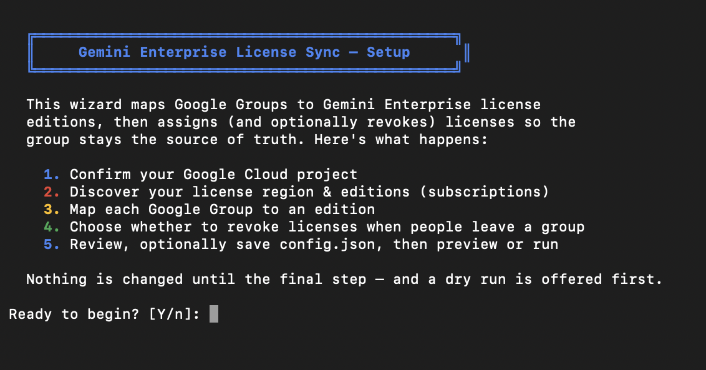

# Gemini Enterprise license assignment script



## The problem

Gemini Enterprise does not currently support group-based license assignment. The console and API require individual email addresses, and auto-assign only works for a single edition, so it cannot differentiate between Frontline, Standard, and Plus users. Managing multiple editions across different user groups means assigning licenses one by one.

## The solution

This script assigns Gemini Enterprise licenses by edition across **one or more Google Cloud projects** using Google Group membership as the source of truth. Define a `projects` list in `config.json` mapping Google Groups to subscription editions per project, and for each configured project the script:

1. Pulls members from each group via `gcloud identity` (caching group memberships across projects within a single run)
2. Assigns the matching license edition to each member via `batchUpdateUserLicenses`
3. Optionally removes licenses from users who are no longer in the group

## How it works

```
┌───────────────────────────┐
│   Google Groups           │
│                           │
│  gemini-plus@company.com  │──► Plus licenses
│  gemini-std@company.com   │──► Standard licenses
│  gemini-fl@company.com    │──► Frontline licenses
└───────────────────────────┘
            │
            ▼
    gcloud identity groups
    memberships list
            │
            ▼
┌───────────────────────────┐
│  batchUpdateUserLicenses  │
│  (Discovery Engine API)   │
│                           │
│  Each user gets the       │
│  licenseConfig matching   │
│  their group's edition    │
└───────────────────────────┘
```

### Required APIs and permissions

Before running the scripts, enable these APIs and grant the required roles in your Google Cloud projects.

#### 1. Enabled APIs

- **Cloud Identity API** (`cloudidentity.googleapis.com`): required on the quota/execution project to query Google Group memberships.
- **Discovery Engine API** (`discoveryengine.googleapis.com`): required on every target project where licenses are managed (and on the quota project when `quota_project_id` or `CLOUDSDK_CORE_PROJECT` is set).

#### 2. IAM roles

The authenticated user or service account needs permissions in both Cloud Identity and Google Cloud.

Cloud Identity / Workspace admin roles (for `gcloud identity groups memberships list`):

- Google Workspace Admin with Groups Reader privileges, OR
- Groups Admin role, OR
- Groups Reader role in Cloud Identity

Google Cloud IAM roles (for querying and assigning licenses via the Discovery Engine API across all configured projects):

- **Discovery Engine Admin** (`roles/discoveryengine.admin`) — or **Discovery Engine Editor** (`roles/discoveryengine.editor`) — on **every target project** listed in `projects[]`. (`roles/discoveryengine.admin` also includes `resourcemanager.projects.get`, allowing automatic `project_number` lookup when `project_number` is omitted.)
- **Service Usage Consumer** (`roles/serviceusage.serviceUsageConsumer`) on the **quota project** sent in `X-Goog-User-Project` (`quota_project_id` or `CLOUDSDK_CORE_PROJECT` when running centrally, or each target project if no central quota project is set).

## Quick start (guided setup)

Run the interactive wizard to walk through project selection (one or more projects), license editions, group mappings, optional quota project, and revocation settings, then run a dry run before making changes:

```bash
./gemini-license-sync.sh --setup
```

The wizard detects your active project, lists available license editions, shows the member count for each group you enter, writes `config.json`, and offers a dry run. Running `./gemini-license-sync.sh` in a terminal with no `config.json` launches the wizard automatically.

For cron or other non-interactive runs, pass `--no-input` so a missing `config.json` fails immediately instead of prompting.

## Manual setup (Cloud Shell)

If you prefer writing the config by hand in Cloud Shell, the script discovers your project ID (for single-project configs) and project number automatically, so you only need to add your group mappings.

```bash
# 1. Verify your environment is ready
./gemini-helpers.sh check-prereqs

# 2. Copy the config template
cp config.json.example config.json
```

### 3. Edit your configuration

Click Open Editor at the top of the Cloud Shell window, open `config.json`, and define one or more entries in the `projects` array:

```json
{
  "quota_project_id": "",
  "projects": [
    {
      "project_id": "my-prod-project",
      "project_number": "",
      "location": "global",
      "endpoint_location": "global",
      "delete_unassigned": false,
      "batch_size": 100,
      "group_mappings": {
        "marketing-team@example.com": "YOUR_SUBSCRIPTION_ID"
      }
    }
  ]
}
```

> Note: When `projects` has a single entry, you can leave `project_id` and `project_number` as empty strings `""` to auto-discover them from your active `gcloud` configuration. With multiple projects, set each entry's `project_id` explicitly (`project_number` still auto-discovers if left empty). Legacy flat single-project `config.json` files are still accepted and automatically wrapped with a deprecation warning, but migrating to the `projects` array format is recommended.

> Tip: If a project has a single license config, set the subscription value to `"auto"` and the script resolves it at startup, so you only need to enter the group email:
>
> ```json
> { "group_mappings": { "your-group@example.com": "auto" } }
> ```
>
> If the project has multiple editions, `"auto"` is ambiguous; the script prints the available configs and skips that project so you can set explicit IDs.

### 4. Find your subscription IDs

To list your subscription IDs across all configured projects, or for a single project:

```bash
./gemini-helpers.sh list-configs
./gemini-helpers.sh --project my-prod-project --location eu list-configs
```

### 5. Preview with a dry run

Preview what the script will do across all configured projects (or target a single project with `--project`) before changing any licenses:

```bash
./gemini-license-sync.sh --dry-run
./gemini-license-sync.sh --dry-run --project my-prod-project
```

Dry run fetches group members and logs planned actions without calling the API to assign or revoke licenses.

### 6. Run the sync

```bash
./gemini-license-sync.sh
./gemini-license-sync.sh --project my-prod-project
```

The script writes its output to a timestamped log file (`gemini-license-sync-YYYYMMDD-HHMMSS.log`). If one project encounters a runtime API error, remaining projects still sync and the script exits non-zero at the end.

## Local execution (optional)

If you run the script from a local terminal instead of Cloud Shell, set `project_id` (and optionally `project_number`) for each entry in `config.json`.

To look up numeric project numbers for all projects in `config.json` (or for a specific project):

```bash
./gemini-helpers.sh get-project-number
./gemini-helpers.sh get-project-number my-gcp-project
```

## Run on Cloud Run jobs

For unattended, scheduled syncs, run the script as a Cloud Run job. This folder includes a `Dockerfile` (Debian slim with a trimmed `gcloud`, `curl`, and `jq`) and an `entrypoint.sh` that loads `config.json` at startup. The job authenticates as its own service account, so you do not need `gcloud auth login` or key files.

Set these variables once for the commands below:

```bash
export PROJECT_ID="my-gcp-project"
export REGION="europe-west1"
export REPO="gemini-license-sync"
export JOB="gemini-license-sync"
export IMAGE="${REGION}-docker.pkg.dev/${PROJECT_ID}/${REPO}/gemini-license-sync:latest"
export SA="gemini-license-sync@${PROJECT_ID}.iam.gserviceaccount.com"

gcloud config set project "$PROJECT_ID"
```

### 1. Enable the APIs

```bash
gcloud services enable \
  run.googleapis.com \
  cloudbuild.googleapis.com \
  artifactregistry.googleapis.com \
  secretmanager.googleapis.com \
  cloudscheduler.googleapis.com \
  cloudidentity.googleapis.com \
  discoveryengine.googleapis.com
```

### 2. Create the Artifact Registry repository

```bash
gcloud artifacts repositories create "$REPO" \
  --repository-format=docker \
  --location="$REGION" \
  --description="Gemini Enterprise license sync images"
```

### 3. Build the image with Cloud Build

From the directory containing the `Dockerfile`:

```bash
gcloud builds submit --region="$REGION" --tag "$IMAGE" .
```

Cloud Build uploads the source, builds the image, and pushes it to Artifact Registry. Expect about two minutes and roughly 120 MB of compressed layers. The build runs as the Compute Engine default service account unless you pass `--service-account`; if it fails with a permissions error, grant that account `roles/artifactregistry.writer` and `roles/logging.logWriter`.

The `Dockerfile` pins the Cloud CLI version through the `GCLOUD_VERSION` build argument. Edit its default to upgrade to a newer release.

### 4. Create the job's service account

```bash
gcloud iam service-accounts create gemini-license-sync \
  --display-name="Gemini Enterprise license sync"

# Quota project permissions (on the project hosting the Cloud Run job)
gcloud projects add-iam-policy-binding "$PROJECT_ID" \
  --member="serviceAccount:${SA}" \
  --role="roles/serviceusage.serviceUsageConsumer"

# Optional: let the script auto-discover project numbers if omitted in config.json
gcloud projects add-iam-policy-binding "$PROJECT_ID" \
  --member="serviceAccount:${SA}" \
  --role="roles/browser"

# Assign and revoke licenses on every target project in config.json
for TARGET_PROJECT in my-prod-project my-dev-project; do
  gcloud projects add-iam-policy-binding "$TARGET_PROJECT" \
    --member="serviceAccount:${SA}" \
    --role="roles/discoveryengine.admin"
done
```

> Important: The service account also needs permission to read Google Group memberships. In the [Google Workspace Admin console](https://admin.google.com), go to Account > Admin roles > Groups Reader > Assign service accounts and add `${SA}`. Without this, every group lookup returns zero members and the sync does nothing. When `delete_unassigned` is `true`, a failed group lookup is skipped instead of treated as empty, so it cannot trigger a mass revoke (see [`DELETE_UNASSIGNED`](#delete_unassigned)).

### 5. Supply the configuration

The entrypoint checks for configuration in this order:

| Source | How |
| --- | --- |
| `CONFIG_JSON` | Literal JSON string (works well with Secret Manager) |
| `CONFIG_GCS_URI` | `gs://bucket/path/config.json`, copied in at startup |
| `/app/config.json` | Baked into the image (if `config.json` exists at build time) or mounted as a volume |

#### Secret Manager (recommended)

Storing `config.json` in Secret Manager keeps group mappings out of the image and lets you update them without rebuilding:

```bash
gcloud secrets create gemini-license-sync-config --data-file=config.json

gcloud secrets add-iam-policy-binding gemini-license-sync-config \
  --member="serviceAccount:${SA}" \
  --role="roles/secretmanager.secretAccessor"
```

Update it later with:

```bash
gcloud secrets versions add gemini-license-sync-config --data-file=config.json
```

#### Cloud Storage

Upload `config.json` to a bucket, grant the service account `roles/storage.objectViewer` on that bucket, and set `CONFIG_GCS_URI` on the job.

For container runs, set `project_id` and `project_number` explicitly in `config.json`, or pass `CLOUDSDK_CORE_PROJECT` (shown below) along with `roles/discoveryengine.admin` / `roles/browser` for auto-discovery.

### 6. Create the job

```bash
gcloud run jobs create "$JOB" \
  --image="$IMAGE" \
  --region="$REGION" \
  --service-account="$SA" \
  --set-secrets="CONFIG_JSON=gemini-license-sync-config:latest" \
  --set-env-vars="CLOUDSDK_CORE_PROJECT=${PROJECT_ID}" \
  --max-retries=1 \
  --task-timeout=30m
```

If you stored the config in Cloud Storage, replace `--set-secrets` with `--set-env-vars="CONFIG_GCS_URI=gs://my-bucket/config.json,CLOUDSDK_CORE_PROJECT=${PROJECT_ID}"`.

The defaults work for a few thousand users. Large tenancies may need a longer `--task-timeout` (up to 24h) and more memory (`--memory=1Gi`).

`--max-retries=1` allows one retry (two attempts total). Because the sync skips users who already hold the right edition, retrying after a transient API error is safe.

### 7. Run the job (dry run first)

```bash
# Preview all configured projects without touching any licenses
gcloud run jobs execute "$JOB" --region="$REGION" --wait \
  --args="--no-input,--dry-run"

# Preview a single project only
gcloud run jobs execute "$JOB" --region="$REGION" --wait \
  --args="--no-input,--dry-run,--project=my-prod-project"

# The real thing (all projects in config.json)
gcloud run jobs execute "$JOB" --region="$REGION" --wait
```

The first execution spends about a minute pulling the image; subsequent runs start faster.

Logs go to Cloud Logging. To tail a run:

```bash
gcloud beta run jobs logs tail "$JOB" --region="$REGION"
```

The container also writes its timestamped log file to ephemeral `/tmp`, while Cloud Logging keeps the durable copy.

If any project or group fails to sync, the script exits non-zero and Cloud Run marks the execution failed so you can alert on it. The script skips a failed group instead of treating it as empty.

### 8. Schedule it

Use Cloud Scheduler to trigger the job on a cron schedule:

```bash
gcloud iam service-accounts create gemini-sync-invoker \
  --display-name="Gemini license sync invoker"

gcloud run jobs add-iam-policy-binding "$JOB" \
  --region="$REGION" \
  --member="serviceAccount:gemini-sync-invoker@${PROJECT_ID}.iam.gserviceaccount.com" \
  --role="roles/run.invoker"

gcloud scheduler jobs create http gemini-license-sync-hourly \
  --location="$REGION" \
  --schedule="0 * * * *" \
  --time-zone="Etc/UTC" \
  --uri="https://${REGION}-run.googleapis.com/apis/run.googleapis.com/v1/namespaces/${PROJECT_ID}/jobs/${JOB}:run" \
  --http-method=POST \
  --oauth-service-account-email="gemini-sync-invoker@${PROJECT_ID}.iam.gserviceaccount.com"
```

Test the trigger without waiting for the next hour:

```bash
gcloud scheduler jobs run gemini-license-sync-hourly --location="$REGION"
```

The trigger fires within a couple of minutes. Check the execution with `gcloud run jobs executions list --job="$JOB" --region="$REGION"`, and inspect the scheduler's view of the attempt with:

```bash
gcloud logging read 'resource.type="cloud_scheduler_job"' --limit=5 --freshness=1h
```

> Note: A scheduled invocation uses the job's configured arguments and runs a live sync. `--dry-run` only applies when you pass `--args=...` manually to `gcloud run jobs execute`.

Once scheduled syncs are running, consider setting `delete_unassigned` to `true` so leaving a group revokes the license on the next run.

### Updating the image

```bash
gcloud builds submit --region="$REGION" --tag "$IMAGE" .
gcloud run jobs update "$JOB" --region="$REGION" --image="$IMAGE"
```

### Cloud Run troubleshooting

| Symptom | Cause |
| --- | --- |
| `ERROR: no configuration found at /app/config.json` | Neither `CONFIG_JSON` nor `CONFIG_GCS_URI` is set and no config was baked in |
| `No members found in group` | The service account is missing the Workspace Groups Reader role (step 4) |
| `Could not auto-discover PROJECT_NUMBER` | Set `project_number` explicitly in `config.json` or ensure `resourcemanager.projects.get` (`roles/discoveryengine.admin` / `roles/browser`) is granted on that project |
| HTTP 403 `USER_PROJECT_DENIED` | Service account lacks `roles/serviceusage.serviceUsageConsumer` on the quota project (`quota_project_id` / `CLOUDSDK_CORE_PROJECT`) |
| HTTP 403 on assignment | Service account lacks `roles/discoveryengine.admin` on the target project |
| Build pushes but the job fails to start | Image built for the wrong architecture (build with Cloud Build for amd64, not locally on an Apple Silicon Mac) |

## Configuration options

### `quota_project_id` (top-level, optional)

Specifies the Google Cloud project sent in the `X-Goog-User-Project` header for all Discovery Engine API calls across every project in `projects[]`. Resolution precedence:

1. `$QUOTA_PROJECT_ID` environment variable
2. `quota_project_id` in `config.json`
3. `$CLOUDSDK_CORE_PROJECT` environment variable
4. Each entry's own `project_id`

Pinning `quota_project_id` (or `CLOUDSDK_CORE_PROJECT`) to the central project hosting the Cloud Run job lets the service account sync licenses across multiple target projects while requiring `roles/serviceusage.serviceUsageConsumer` only on that quota project.

### `DELETE_UNASSIGNED`

Controls whether groups act as the authoritative source for revoking licenses from users who left a group or were licensed manually.

| Value | Behavior |
| --- | --- |
| `false` (default) | Only adds or updates licenses. Users who left a group keep their license. Safe for initial runs. |
| `true` | After assigning, lists every assigned license in the project and revokes anyone who should not hold one, including licenses granted manually in the console. |

When set to `true`, the script reconciles assignments using these rules:

- For an edition listed in `group_mappings`, anyone assigned to that edition who is no longer in its mapped group has their license revoked.
- Everything else in the user store is checked against the union of all configured groups. That covers subscriptions not listed in `group_mappings` and console-granted seats recorded with no subscription attached: the holder keeps the license if they appear in any configured group, and loses it otherwise. Configured groups apply across the whole project, including editions not listed in `group_mappings`.
- Users in any configured group are never revoked. If they hold the wrong edition, the script reassigns them to the edition mapped to their group.
- The script only reconciles an edition if its group lookup succeeded. If a group lookup fails (for example, from a permissions error), it skips that edition and skips reconciling seats outside `group_mappings`, because an incomplete group list would make active users look like leavers.
- If a group lookup succeeds and returns no members, the script revokes every license for that edition, treating an empty group as meaning nobody should hold it.

Every run prints the current license snapshot grouped by subscription and flags subscriptions missing from `config.json`, so you can see what the union rule would affect. Preview with `--dry-run`.

> Warning: Keep `delete_unassigned` set to `false` on your first run until you verify assignments with `./gemini-helpers.sh list-licenses`. Revocation takes effect immediately, and affected users lose access right away.

### `BATCH_SIZE`

The script sends users in batches to stay within API payload limits. The default is `100`; adjust it if you hit issues with very large groups.

### `location` / `endpoint_location`

Licenses are bound to a specific multi-region. `global`, `us`, and `eu` always work; additional multi-regions (such as `ca` for Canada and `au` for Australia) are whitelisted per project or customer. Use the multi-region code (`ca`), not a region name (`northamerica-northeast1`, which is not valid here). Each entry in `projects[]` targets one multi-region.

The `--setup` wizard probes the common multi-regions to detect where your subscriptions live and lets you enter a whitelisted region manually if it cannot detect one. When editing `config.json` by hand, set `location` and `endpoint_location` to the multi-region shown in the Cloud console under Location.

## Helper script

`gemini-helpers.sh` includes standalone utilities for discovery and verification across one or all configured projects:

```bash
./gemini-helpers.sh check-prereqs                         # Verify gcloud, curl, jq, auth, and per-project IAM
./gemini-helpers.sh get-project-number [<project_id>]     # Look up numeric project number(s)
./gemini-helpers.sh list-configs                          # List license config IDs for every project in config.json
./gemini-helpers.sh --project <id> list-configs           # List license config IDs for a single project
./gemini-helpers.sh list-licenses                         # List currently assigned user licenses per project
./gemini-helpers.sh [--project <id>] find-user <email>    # Show the raw license record for one user
```

Optional flags (`--project <id>`, `--location <loc>`, `--config <path>`) can be passed before or after the command, including for projects not yet added to `config.json`. You can also export `PROJECT_ID`, `LOCATION`, `ENDPOINT_LOCATION`, or `QUOTA_PROJECT_ID` in your shell as fallbacks.

## Scheduling for ongoing sync

You can run the sync on a schedule in three ways:

### Cloud Run job + Cloud Scheduler (recommended)

Build the bundled `Dockerfile` and trigger it on a schedule so you do not have to keep a local machine authenticated. See [Run on Cloud Run jobs](#run-on-cloud-run-jobs).

### Cron job

On any machine with `gcloud` authenticated:

```bash
# Run every hour
0 * * * * /path/to/gemini-license-sync.sh >> /var/log/gemini-sync.log 2>&1
```

### Systemd timer

On Linux servers, you can also trigger the script with a systemd timer.

Once scheduled runs are in place, consider setting `delete_unassigned` to `true` in `config.json` so removing a user from a group revokes their license on the next run.

## API reference

The script uses two APIs.

### Cloud Identity: list group members

```
gcloud identity groups memberships list --group-email=GROUP
```

Returns all members of a Google Group and their email addresses.

### Discovery Engine: batch update user licenses

```
POST https://{LOCATION}-discoveryengine.googleapis.com/v1/projects/{PROJECT}/locations/{LOCATION}/userStores/default_user_store:batchUpdateUserLicenses
```

Accepts an array of `userLicenses` objects, each with a `userPrincipal` (email) and `licenseConfig` (edition-specific subscription path).

The `licenseConfig` path format is:

```
projects/{PROJECT_NUMBER}/locations/{LOCATION}/licenseConfigs/{SUBSCRIPTION_ID}
```

## Verifying assignments

List all currently assigned licenses to confirm the sync worked:

```bash
./gemini-helpers.sh list-licenses
```

## Troubleshooting

| Symptom | Cause and fix |
|---------|---------------|
| `"No members found in group"` | Check that the authenticated `gcloud` account can list group memberships. You may need the Groups Reader or Groups Admin role in Cloud Identity. |
| HTTP 403 on license assignment | Confirm the account has `discoveryengine.userLicenses.batchUpdate` permission and Billing Account Administrator on the billing account tied to the subscriptions. |
| HTTP 400 / invalid `licenseConfig` | Check your `PROJECT_NUMBER` (not project ID) and `SUBSCRIPTION_ID`. Run `./gemini-helpers.sh list-configs` to list valid configs. |
| Users not gaining access after assignment | License propagation can take up to 30 minutes. Make sure users also have the Discovery Engine User IAM role on the project. |
| Config validation errors | The script validates `config.json` before running. If you see placeholder errors, replace them with real values from `./gemini-helpers.sh get-project-number` and `./gemini-helpers.sh list-configs`. |
