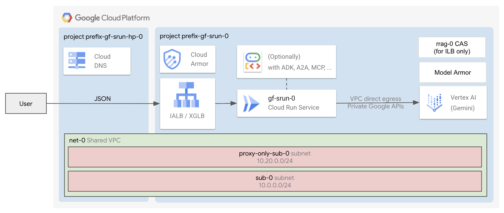

# Serve Private Models

The factory deploys an open model from Vertex AI Model Garden (defaulting to Gemma 3) on a private Vertex AI Endpoint exposed over Private Service Connect (PSC), together with a secure Cloud Run instance to serve AI applications that consume the private model endpoint.

## Applications

After the [1-apps](1-apps/README.md) deployment finishes, the commands to deploy the application will be displayed on screen.

Serve Private Models allows deploying:

- **Chat:** a secure [FastAPI backend](./1-apps/apps/chat/README.md) exposing a JSON interface that sends requests over Private Service Connect to the privately deployed Model Garden endpoint (with optional Model Armor sanitization).

## Core Components

The deployment includes:

- A **Vertex AI Model Garden Endpoint** configured with **Private Service Connect (PSC)** (`enable_private_service_connect = true`), plus a **PSC consumer internal IP address** and **PSC forwarding rule** in your VPC targeting the endpoint's service attachment.

- An instance of **Cloud Run** (with authentication and direct VPC egress to reach the private PSC endpoint).

- An **exposure layer**, made of:
  - A **Global external application load balancer** (+ Cloud Armor IP allowlist security backend policy + HTTP to HTTPS redirect + managed certificates). This is created by default.
  - An **Internal application load balancer** (+ Cloud Armor IP allowlist security backend policy + HTTP to HTTPS redirect + managed certificates + CAS + Cloud DNS private zone). This is optional.

- By default, a **host project**, a **shared VPC**, a subnet, private Google APIs routes and DNS policies. Optionally, you can use your own host project and shared VPCs.

- A **service project** with all the necessary APIs, service accounts, custom roles, and permissions set.

## Apply the factory

- Enter the [0-prereqs](0-prereqs/README.md) folder and follow the instructions to setup the GCP projects, service accounts and permissions.
- Go to the [1-apps](1-apps/README.md) folder and follow the instructions to deploy the components inside the service project.
